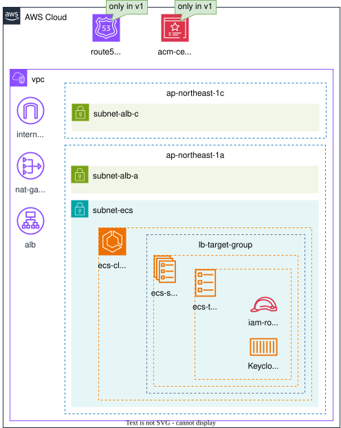

# terraform-templates

 English

# AWS
## Summary
| Project | Link | Description |
|-|-|-|
| tf-sample/v6 | [Sources](./AWS/tf-sample/v6/) | Terraform samples built with AWS provider v6.x. This cannot be deployed. |
| tf-keycloak | [Sources(v0)](./AWS/tf-keycloak/v0/) [Sources(v1)](./AWS/tf-keycloak/v1/) [Sources(v2)](./AWS/tf-keycloak/v2/) [Details](#tf-keycloak) | In v0, you can run Keycloak from the official image without a database and over HTTP. v1 is based on v0 and changes the protocol to HTTPS. v2 is based on v0 and adds database support. |
| tf-backstage | [Sources](./AWS/tf-backstage/) [Details](#tf-backstage) | You can run Backstage from the community image over HTTP. |
| tf-ses | [Sources](./AWS/tf-ses/) [Details](#tf-ses) | You can send emails using a public domain with SES. |
| tf-pullthroughcache | [Sources](./AWS/tf-pullthroughcache/) [Details](#tf-pullthroughcache) | You can cache container images via ECR. |
| tf-rdscluster | [Sources](./AWS/tf-rdscluster/) [Details](#tf-rdscluster) | You can run an Aurora PostgreSQL cluster with a writer and a reader instance. |
## Details
### [tf-keycloak](./AWS/tf-keycloak/)

Overview

Requirements

- To deploy this module, Terraform must authenticate with your AWS account.
- Set the following environment variables before running the module: 
    - `TF_VAR_AWS_REGION`
    - `TF_VAR_AWS_ACCOUNT_ID`
    - `TF_VAR_AWS_ACCESS_KEY_ID`
    - `TF_VAR_AWS_SECRET_ACCESS_KEY`
- When using v1, `TF_VAR_AWS_DOMAIN` is additionally required.

### [tf-backstage](./AWS/tf-backstage/)

Overview

- The architecture diagram is not yet available.

Requirements

- To deploy this module, Terraform must authenticate with your AWS account.
- Set the following environment variables before running the module: 
    - `TF_VAR_AWS_REGION`
    - `TF_VAR_AWS_ACCOUNT_ID`
    - `TF_VAR_AWS_ACCESS_KEY_ID`
    - `TF_VAR_AWS_SECRET_ACCESS_KEY`
    - `TF_VAR_GITHUB_TOKEN`

### [tf-ses](./AWS/tf-ses/)

Overview

- The architecture diagram is not yet available.

Requirements

- To deploy this module, Terraform must authenticate with your AWS account and you also need a public hosted zone associated with a valid public domain.
- Set the following environment variables before running the module: 
    - `TF_VAR_AWS_REGION`
    - `TF_VAR_AWS_ACCOUNT_ID`
    - `TF_VAR_AWS_ACCESS_KEY_ID`
    - `TF_VAR_AWS_SECRET_ACCESS_KEY`
    - `TF_VAR_AWS_DOMAIN`

### [tf-pullthroughcache](./AWS/tf-pullthroughcache/)

Overview

- The architecture diagram is not yet available.

Requirements

- To deploy this module, Terraform must authenticate with your AWS account, and you also need GitHub credentials and Docker credentials.
- Set the following environment variables before running the module: 
    - `TF_VAR_AWS_REGION`
    - `TF_VAR_AWS_ACCOUNT_ID`
    - `TF_VAR_AWS_ACCESS_KEY_ID`
    - `TF_VAR_AWS_SECRET_ACCESS_KEY`
    - `TF_VAR_DOCKER_USERNAME`
    - `TF_VAR_DOCKER_TOKEN`
    - `TF_VAR_GITHUB_USERNAME`
    - `TF_VAR_GITHUB_TOKEN`

### [tf-rdscluster](./AWS/tf-rdscluster/)

Overview

- The architecture diagram is not yet available.

Requirements

- To deploy this module, Terraform must authenticate with your AWS account.
- Set the following environment variables before running the module: 
    - `TF_VAR_AWS_REGION`
    - `TF_VAR_AWS_ACCOUNT_ID`
    - `TF_VAR_AWS_ACCESS_KEY_ID`
    - `TF_VAR_AWS_SECRET_ACCESS_KEY`

# Azure
## Summary
| Project | Link | Description |
|-|-|-|
| tf-sample/v4 | [Sources](./Azure/tf-sample/v4/) | Terraform samples built with Azure provider v4.x. This cannot be deployed. |
| tf-sample/v5 | [Sources](./Azure/tf-sample/v5/) | Terraform samples built with Azure provider v5.x. This cannot be deployed. |

# GCP
## Summary
| Project | Link | Description |
|-|-|-|
| tf-sample/v7 | [Sources](./GCP/tf-sample/v7/) | Terraform samples built with GCP provider v7.x. This cannot be deployed. |
| tf-sample/v8 | [Sources](./GCP/tf-sample/v8/) | Terraform samples built with GCP provider v8.x. This cannot be deployed. |

# IBM
## Summary
| Project | Link | Description |
|-|-|-|
| tf-sample/v1 | [Sources](./IBM/tf-sample/v1/) | Terraform samples built with IBM provider v1.x. This cannot be deployed. |
| tf-sample/v2 | [Sources](./IBM/tf-sample/v2/) | Terraform samples built with IBM provider v2.x. This cannot be deployed. |

# OCI
## Summary
| Project | Link | Description |
|-|-|-|
| tf-sample/v7 | [Sources](./OCI/tf-sample/v7/) | Terraform samples built with OCI provider v7.x. This cannot be deployed. |
| tf-sample/v8 | [Sources](./OCI/tf-sample/v8/) | Terraform samples built with OCI provider v8.x. This cannot be deployed. |
| tf-sample/v9 | [Sources](./OCI/tf-sample/v9/) | Terraform samples built with OCI provider v9.x. This cannot be deployed. |

# Tencent
## Summary
| Project | Link | Description |
|-|-|-|
| tf-sample/v1 | [Sources](./Tencent/tf-sample/v1/) | Terraform samples built with Tencent provider v1.x. This cannot be deployed. |

# Alicloud
## Summary
| Project | Link | Description |
|-|-|-|
| tf-sample/v1 | [Sources](./Alicloud/tf-sample/v1/) | Terraform samples built with Alicloud provider v1.x. This cannot be deployed. |
| tf-sample/v2 | [Sources](./Alicloud/tf-sample/v2/) | Terraform samples built with Alicloud provider v2.x. This cannot be deployed. |

# Sacloud
## Summary
| Project | Link | Description |
|-|-|-|
| tf-sample/v2 | [Sources](./Sacloud/tf-sample/v2/) | Terraform samples built with Sacloud provider v2.x. This cannot be deployed. |

 Español (traducción automática)

# AWS
## Resumen
| Proyecto | Enlace | Descripción |
|-|-|-|
| tf-sample/v6 | [Código fuente](./AWS/tf-sample/v6/) | Ejemplos de Terraform creados con el proveedor de AWS v6.x. No se puede desplegar. |
| tf-keycloak | [Código fuente (v0)](./AWS/tf-keycloak/v0/) [Código fuente (v1)](./AWS/tf-keycloak/v1/) [Código fuente (v2)](./AWS/tf-keycloak/v2/) [Detalles](#tf-keycloak-1) | En v0, puede ejecutar Keycloak a partir de la imagen oficial, sin base de datos y sobre HTTP. v1 se basa en v0 y cambia el protocolo a HTTPS. v2 se basa en v0 y añade soporte para base de datos. |
| tf-backstage | [Código fuente](./AWS/tf-backstage/) [Detalles](#tf-backstage-1) | Puede ejecutar Backstage a partir de la imagen de la comunidad sobre HTTP. |
| tf-ses | [Código fuente](./AWS/tf-ses/) [Detalles](#tf-ses-1) | Puede enviar correos electrónicos con SES usando un dominio público. |
| tf-pullthroughcache | [Código fuente](./AWS/tf-pullthroughcache/) [Detalles](#tf-pullthroughcache-1) | Puede almacenar en caché imágenes de contenedores mediante ECR. |
| tf-rdscluster | [Código fuente](./AWS/tf-rdscluster/) [Detalles](#tf-rdscluster-1) | Puede ejecutar un clúster de Aurora PostgreSQL con una instancia de escritura y una de lectura. |
## Detalles
### [tf-keycloak](./AWS/tf-keycloak/)

Descripción general

Requisitos

- Para desplegar este módulo, Terraform debe autenticarse con su cuenta de AWS.
- Defina las siguientes variables de entorno antes de ejecutar el módulo: 
    - `TF_VAR_AWS_REGION`
    - `TF_VAR_AWS_ACCOUNT_ID`
    - `TF_VAR_AWS_ACCESS_KEY_ID`
    - `TF_VAR_AWS_SECRET_ACCESS_KEY`
- Al usar v1, también se requiere `TF_VAR_AWS_DOMAIN`.

### [tf-backstage](./AWS/tf-backstage/)

Descripción general

- El diagrama de arquitectura aún no está disponible.

Requisitos

- Para desplegar este módulo, Terraform debe autenticarse con su cuenta de AWS.
- Defina las siguientes variables de entorno antes de ejecutar el módulo: 
    - `TF_VAR_AWS_REGION`
    - `TF_VAR_AWS_ACCOUNT_ID`
    - `TF_VAR_AWS_ACCESS_KEY_ID`
    - `TF_VAR_AWS_SECRET_ACCESS_KEY`
    - `TF_VAR_GITHUB_TOKEN`

### [tf-ses](./AWS/tf-ses/)

Descripción general

- El diagrama de arquitectura aún no está disponible.

Requisitos

- Para desplegar este módulo, Terraform debe autenticarse con su cuenta de AWS y, además, necesita una zona alojada pública asociada a un dominio público válido.
- Defina las siguientes variables de entorno antes de ejecutar el módulo: 
    - `TF_VAR_AWS_REGION`
    - `TF_VAR_AWS_ACCOUNT_ID`
    - `TF_VAR_AWS_ACCESS_KEY_ID`
    - `TF_VAR_AWS_SECRET_ACCESS_KEY`
    - `TF_VAR_AWS_DOMAIN`

### [tf-pullthroughcache](./AWS/tf-pullthroughcache/)

Descripción general

- El diagrama de arquitectura aún no está disponible.

Requisitos

- Para desplegar este módulo, Terraform debe autenticarse con su cuenta de AWS y, además, necesita credenciales de GitHub y de Docker.
- Defina las siguientes variables de entorno antes de ejecutar el módulo: 
    - `TF_VAR_AWS_REGION`
    - `TF_VAR_AWS_ACCOUNT_ID`
    - `TF_VAR_AWS_ACCESS_KEY_ID`
    - `TF_VAR_AWS_SECRET_ACCESS_KEY`
    - `TF_VAR_DOCKER_USERNAME`
    - `TF_VAR_DOCKER_TOKEN`
    - `TF_VAR_GITHUB_USERNAME`
    - `TF_VAR_GITHUB_TOKEN`

### [tf-rdscluster](./AWS/tf-rdscluster/)

Descripción general

- El diagrama de arquitectura aún no está disponible.

Requisitos

- Para desplegar este módulo, Terraform debe autenticarse con su cuenta de AWS.
- Defina las siguientes variables de entorno antes de ejecutar el módulo: 
    - `TF_VAR_AWS_REGION`
    - `TF_VAR_AWS_ACCOUNT_ID`
    - `TF_VAR_AWS_ACCESS_KEY_ID`
    - `TF_VAR_AWS_SECRET_ACCESS_KEY`

# Azure
## Resumen
| Proyecto | Enlace | Descripción |
|-|-|-|
| tf-sample/v4 | [Código fuente](./Azure/tf-sample/v4/) | Ejemplos de Terraform creados con el proveedor de Azure v4.x. No se puede desplegar. |
| tf-sample/v5 | [Código fuente](./Azure/tf-sample/v5/) | Ejemplos de Terraform creados con el proveedor de Azure v5.x. No se puede desplegar. |

# GCP
## Resumen
| Proyecto | Enlace | Descripción |
|-|-|-|
| tf-sample/v7 | [Código fuente](./GCP/tf-sample/v7/) | Ejemplos de Terraform creados con el proveedor de GCP v7.x. No se puede desplegar. |
| tf-sample/v8 | [Código fuente](./GCP/tf-sample/v8/) | Ejemplos de Terraform creados con el proveedor de GCP v8.x. No se puede desplegar. |

# IBM
## Resumen
| Proyecto | Enlace | Descripción |
|-|-|-|
| tf-sample/v1 | [Código fuente](./IBM/tf-sample/v1/) | Ejemplos de Terraform creados con el proveedor de IBM v1.x. No se puede desplegar. |
| tf-sample/v2 | [Código fuente](./IBM/tf-sample/v2/) | Ejemplos de Terraform creados con el proveedor de IBM v2.x. No se puede desplegar. |

# OCI
## Resumen
| Proyecto | Enlace | Descripción |
|-|-|-|
| tf-sample/v7 | [Código fuente](./OCI/tf-sample/v7/) | Ejemplos de Terraform creados con el proveedor de OCI v7.x. No se puede desplegar. |
| tf-sample/v8 | [Código fuente](./OCI/tf-sample/v8/) | Ejemplos de Terraform creados con el proveedor de OCI v8.x. No se puede desplegar. |
| tf-sample/v9 | [Código fuente](./OCI/tf-sample/v9/) | Ejemplos de Terraform creados con el proveedor de OCI v9.x. No se puede desplegar. |

# Tencent
## Resumen
| Proyecto | Enlace | Descripción |
|-|-|-|
| tf-sample/v1 | [Código fuente](./Tencent/tf-sample/v1/) | Ejemplos de Terraform creados con el proveedor de Tencent v1.x. No se puede desplegar. |

# Alicloud
## Resumen
| Proyecto | Enlace | Descripción |
|-|-|-|
| tf-sample/v1 | [Código fuente](./Alicloud/tf-sample/v1/) | Ejemplos de Terraform creados con el proveedor de Alicloud v1.x. No se puede desplegar. |
| tf-sample/v2 | [Código fuente](./Alicloud/tf-sample/v2/) | Ejemplos de Terraform creados con el proveedor de Alicloud v2.x. No se puede desplegar. |

# Sacloud
## Resumen
| Proyecto | Enlace | Descripción |
|-|-|-|
| tf-sample/v2 | [Código fuente](./Sacloud/tf-sample/v2/) | Ejemplos de Terraform creados con el proveedor de Sacloud v2.x. No se puede desplegar. |

 Português (tradução automática)

# AWS
## Resumo
| Projeto | Link | Descrição |
|-|-|-|
| tf-sample/v6 | [Código-fonte](./AWS/tf-sample/v6/) | Exemplos de Terraform criados com o provedor AWS v6.x. Não pode ser implantado. |
| tf-keycloak | [Código-fonte (v0)](./AWS/tf-keycloak/v0/) [Código-fonte (v1)](./AWS/tf-keycloak/v1/) [Código-fonte (v2)](./AWS/tf-keycloak/v2/) [Detalhes](#tf-keycloak-2) | Na v0, você pode executar o Keycloak a partir da imagem oficial, sem banco de dados e via HTTP. A v1 é baseada na v0 e altera o protocolo para HTTPS. A v2 é baseada na v0 e adiciona suporte a banco de dados. |
| tf-backstage | [Código-fonte](./AWS/tf-backstage/) [Detalhes](#tf-backstage-2) | Você pode executar o Backstage a partir da imagem da comunidade via HTTP. |
| tf-ses | [Código-fonte](./AWS/tf-ses/) [Detalhes](#tf-ses-2) | Você pode enviar e-mails com o SES usando um domínio público. |
| tf-pullthroughcache | [Código-fonte](./AWS/tf-pullthroughcache/) [Detalhes](#tf-pullthroughcache-2) | Você pode armazenar imagens de contêiner em cache via ECR. |
| tf-rdscluster | [Código-fonte](./AWS/tf-rdscluster/) [Detalhes](#tf-rdscluster-2) | Você pode executar um cluster Aurora PostgreSQL com uma instância de gravação e uma de leitura. |
## Detalhes
### [tf-keycloak](./AWS/tf-keycloak/)

Visão geral

Requisitos

- Para implantar este módulo, o Terraform precisa se autenticar na sua conta da AWS.
- Defina as seguintes variáveis de ambiente antes de executar o módulo: 
    - `TF_VAR_AWS_REGION`
    - `TF_VAR_AWS_ACCOUNT_ID`
    - `TF_VAR_AWS_ACCESS_KEY_ID`
    - `TF_VAR_AWS_SECRET_ACCESS_KEY`
- Ao usar a v1, `TF_VAR_AWS_DOMAIN` também é necessária.

### [tf-backstage](./AWS/tf-backstage/)

Visão geral

- O diagrama de arquitetura ainda não está disponível.

Requisitos

- Para implantar este módulo, o Terraform precisa se autenticar na sua conta da AWS.
- Defina as seguintes variáveis de ambiente antes de executar o módulo: 
    - `TF_VAR_AWS_REGION`
    - `TF_VAR_AWS_ACCOUNT_ID`
    - `TF_VAR_AWS_ACCESS_KEY_ID`
    - `TF_VAR_AWS_SECRET_ACCESS_KEY`
    - `TF_VAR_GITHUB_TOKEN`

### [tf-ses](./AWS/tf-ses/)

Visão geral

- O diagrama de arquitetura ainda não está disponível.

Requisitos

- Para implantar este módulo, o Terraform precisa se autenticar na sua conta da AWS, e você também precisa de uma zona hospedada pública associada a um domínio público válido.
- Defina as seguintes variáveis de ambiente antes de executar o módulo: 
    - `TF_VAR_AWS_REGION`
    - `TF_VAR_AWS_ACCOUNT_ID`
    - `TF_VAR_AWS_ACCESS_KEY_ID`
    - `TF_VAR_AWS_SECRET_ACCESS_KEY`
    - `TF_VAR_AWS_DOMAIN`

### [tf-pullthroughcache](./AWS/tf-pullthroughcache/)

Visão geral

- O diagrama de arquitetura ainda não está disponível.

Requisitos

- Para implantar este módulo, o Terraform precisa se autenticar na sua conta da AWS, e você também precisa de credenciais do GitHub e do Docker.
- Defina as seguintes variáveis de ambiente antes de executar o módulo: 
    - `TF_VAR_AWS_REGION`
    - `TF_VAR_AWS_ACCOUNT_ID`
    - `TF_VAR_AWS_ACCESS_KEY_ID`
    - `TF_VAR_AWS_SECRET_ACCESS_KEY`
    - `TF_VAR_DOCKER_USERNAME`
    - `TF_VAR_DOCKER_TOKEN`
    - `TF_VAR_GITHUB_USERNAME`
    - `TF_VAR_GITHUB_TOKEN`

### [tf-rdscluster](./AWS/tf-rdscluster/)

Visão geral

- O diagrama de arquitetura ainda não está disponível.

Requisitos

- Para implantar este módulo, o Terraform precisa se autenticar na sua conta da AWS.
- Defina as seguintes variáveis de ambiente antes de executar o módulo: 
    - `TF_VAR_AWS_REGION`
    - `TF_VAR_AWS_ACCOUNT_ID`
    - `TF_VAR_AWS_ACCESS_KEY_ID`
    - `TF_VAR_AWS_SECRET_ACCESS_KEY`

# Azure
## Resumo
| Projeto | Link | Descrição |
|-|-|-|
| tf-sample/v4 | [Código-fonte](./Azure/tf-sample/v4/) | Exemplos de Terraform criados com o provedor Azure v4.x. Não pode ser implantado. |
| tf-sample/v5 | [Código-fonte](./Azure/tf-sample/v5/) | Exemplos de Terraform criados com o provedor Azure v5.x. Não pode ser implantado. |

# GCP
## Resumo
| Projeto | Link | Descrição |
|-|-|-|
| tf-sample/v7 | [Código-fonte](./GCP/tf-sample/v7/) | Exemplos de Terraform criados com o provedor GCP v7.x. Não pode ser implantado. |
| tf-sample/v8 | [Código-fonte](./GCP/tf-sample/v8/) | Exemplos de Terraform criados com o provedor GCP v8.x. Não pode ser implantado. |

# IBM
## Resumo
| Projeto | Link | Descrição |
|-|-|-|
| tf-sample/v1 | [Código-fonte](./IBM/tf-sample/v1/) | Exemplos de Terraform criados com o provedor IBM v1.x. Não pode ser implantado. |
| tf-sample/v2 | [Código-fonte](./IBM/tf-sample/v2/) | Exemplos de Terraform criados com o provedor IBM v2.x. Não pode ser implantado. |

# OCI
## Resumo
| Projeto | Link | Descrição |
|-|-|-|
| tf-sample/v7 | [Código-fonte](./OCI/tf-sample/v7/) | Exemplos de Terraform criados com o provedor OCI v7.x. Não pode ser implantado. |
| tf-sample/v8 | [Código-fonte](./OCI/tf-sample/v8/) | Exemplos de Terraform criados com o provedor OCI v8.x. Não pode ser implantado. |
| tf-sample/v9 | [Código-fonte](./OCI/tf-sample/v9/) | Exemplos de Terraform criados com o provedor OCI v9.x. Não pode ser implantado. |

# Tencent
## Resumo
| Projeto | Link | Descrição |
|-|-|-|
| tf-sample/v1 | [Código-fonte](./Tencent/tf-sample/v1/) | Exemplos de Terraform criados com o provedor Tencent v1.x. Não pode ser implantado. |

# Alicloud
## Resumo
| Projeto | Link | Descrição |
|-|-|-|
| tf-sample/v1 | [Código-fonte](./Alicloud/tf-sample/v1/) | Exemplos de Terraform criados com o provedor Alicloud v1.x. Não pode ser implantado. |
| tf-sample/v2 | [Código-fonte](./Alicloud/tf-sample/v2/) | Exemplos de Terraform criados com o provedor Alicloud v2.x. Não pode ser implantado. |

# Sacloud
## Resumo
| Projeto | Link | Descrição |
|-|-|-|
| tf-sample/v2 | [Código-fonte](./Sacloud/tf-sample/v2/) | Exemplos de Terraform criados com o provedor Sacloud v2.x. Não pode ser implantado. |

